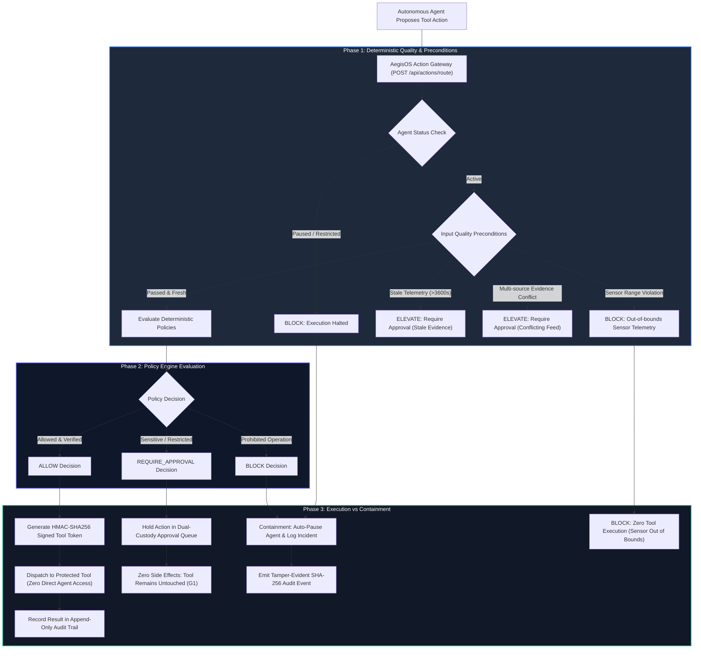
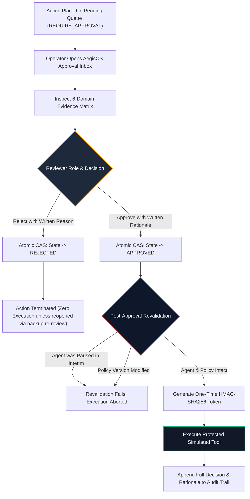
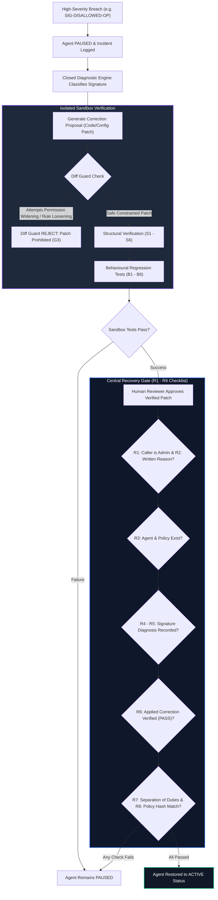

# 🛡️ AegisOS — Defence AI Governance & Human Accountability Control Plane

**Hackathon CODEX 3.0 — Problem Statement 5 (PS5): AI Agent Governance & Control Plane**  
*An Independent Deterministic Governance Layer for Autonomous Systems (Synthetic, Non-Operational Data Only).*

[](https://nodejs.org)
[](https://www.typescriptlang.org)
[](https://vitejs.dev)
[]()
[]()

> **⚠️ DEMO ENVIRONMENT NOTICE & DEFENCE SCOPE DISCLAIMER:**  
> This platform is an unclassified academic/hackathon demonstration running on strictly synthetic, simulated, non-operational data. It possesses **zero** connectivity to classified networks, operational defence infrastructure, real weapon systems, or live command-and-control networks. All agent actions, telemetry, sensor streams, and tool executions occur inside an isolated simulated sandbox.

---

## 🎯 1. The Problem Statement (PS5 Breakdown)

### The Core Challenge
Autonomous AI agents are increasingly entrusted with complex, multi-step tasks across enterprise, aerospace, cyber, and defence-support operations. These agents can ingest sensory telemetry, form plans, and autonomously invoke tools (databases, firewalls, provisioning scripts, external APIs).

However, autonomous systems introduce existential operational risks:
1. **The "Monitoring is Too Late" Fallacy:** Passive post-execution logging or dashboard monitoring is useless once an agent executes an unauthorized, destructive, or invalid command (e.g., wiping firewall credentials, dispatching faulty maintenance work orders, or executing actions based on corrupted sensor feeds).
2. **LLM Non-Determinism & Hallucination:** Relying on Large Language Models for self-policing or policy evaluation is fundamentally insecure. LLMs suffer from prompt injections, hallucinations, probabilistic drift, and unpredictable edge-case handling.
3. **Privilege Widening in Self-Healing ("Silent Degradation"):** When autonomous systems detect failures and attempt self-correction, automated debuggers often secretly loosen security rules, lower safety thresholds, or grant unauthorized permissions simply to make tasks succeed.
4. **Lack of Dual-Custody & Cryptographic Accountability:** In high-consequence domains, high-risk operations cannot be unilateral; they require verifiable human dual-custody, mandatory written operational justification, atomic state synchronization, and tamper-evident audit trails.

---

## 💡 2. What We Built to Solve PS5: AegisOS

**AegisOS** is an **independent, zero-trust governance control plane** situated strictly between autonomous AI agents and protected execution environments. Agents have **zero direct credentials** to tools. Every single tool invocation must be proposed as an action, evaluated against immutable policies and numerical sensor quality rules, and validated before execution can occur.

```
+-------------------------------------------------------------------------------------------------------+
|                                        AEGISOS CONTROL PLANE                                          |
|                                                                                                       |
|   +--------------------+       +------------------------------------+       +---------------------+   |
|   |  Autonomous Agent  | ----> |  Deterministic Decision Gateway    | ----> |   Protected Tools   |   |
|   |  (No Credentials)  |       |  (Zero LLM, Input Quality Precond) |       |  (HMAC Token Only)  |   |
|   +--------------------+       +------------------------------------+       +---------------------+   |
|                                                  |                                                    |
|                                       [Hold / Require Approval]                                       |
|                                                  v                                                    |
|                                +------------------------------------+                                 |
|                                |   Human-in-the-Loop Dual Custody   |                                 |
|                                |   (Atomic CAS + Revalidation)      |                                 |
|                                +------------------------------------+                                 |
|                                                  |                                                    |
|                                             [Violation]                                               |
|                                                  v                                                    |
|                                +------------------------------------+                                 |
|                                | Closed Triage & Diff Guard Sandbox |                                 |
|                                | (Central Recovery Gate R1 - R9)    |                                 |
|                                +------------------------------------+                                 |
+-------------------------------------------------------------------------------------------------------+
```

### The 4 Core Architectural Invariants (G1–G4)
- **G1 — Boundary Invariant (Strict Zero Side-Effects):** Actions that evaluate to `BLOCK` or `REQUIRE_APPROVAL` produce strictly **zero** tool execution or state mutation. Protected tools remain completely untouched.
- **G2 — Approval Invariant (Dual-Custody with Revalidation):** Sensitive or uncertain actions require explicit human approval with mandatory written rationale. Before firing, execution tokens revalidate that agent and policy states have not drifted between approval and execution.
- **G3 — Recovery Invariant (Diff Guard & Anti-Widening):** Diagnostics propose workflow patches, but the **Diff Guard** strictly rejects patches that expand permissions, drop required checks, or weaken policy thresholds. Recovery requires passing structural (S1–S6), behavioural (B1–B6), and the central **R1–R9 checklist**.
- **G4 — Deterministic Authority (Zero LLM in the Critical Path):** Enforcement decisions (`ALLOW`, `REQUIRE_APPROVAL`, `BLOCK`) are governed entirely by pure, deterministic TypeScript evaluators and cryptographic checks.

---

## 🔄 3. End-to-End Governance Flowcharts

### Flowchart 1: Action Proposal & Deterministic Enforcement Pipeline
Every tool action proposed by an agent passes through this gateway. An action cannot touch a simulated tool without a time-limited HMAC-SHA256 signed execution token.



---

### Flowchart 2: Human-in-the-Loop Dual-Custody Approval
Guards against unauthorized execution, human bypass, and race conditions via Atomic Compare-And-Swap (CAS) and pre-execution revalidation.



---

### Flowchart 3: Closed Diagnostics, Sandbox Regression & Central Recovery Gate (R1–R9)
When an agent is paused due to a violation, AegisOS enforces closed diagnostic signature triage, sandbox verification, and a central recovery checklist to prevent permission widening.



---

## 🧩 4. System Components & Architecture

AegisOS is built across a modular backend and a high-fidelity tactical operator frontend:

```
codex/
├── backend/                        # Node.js + Express + TypeScript Backend
│   ├── src/
│   │   ├── engine/                 # Core Governance Logic
│   │   │   ├── evaluator.ts        # Pure deterministic policy decision engine
│   │   │   ├── gateway.ts          # Action routing & HMAC-SHA256 tool token issuing
│   │   │   ├── inputQuality.ts     # Numerical sensor profiles, freshness & conflicts
│   │   │   ├── approval.ts         # Dual-custody workflow, CAS transitions, revalidation
│   │   │   ├── diagnostics.ts      # Closed signature catalog & root-cause classifier
│   │   │   ├── sandbox.ts          # S1–S6 structural, B1–B6 behavioural & Diff Guard
│   │   │   ├── resumeGate.ts       # Central R1–R9 resumption checklist validator
│   │   │   ├── incidentReport.ts   # 11-section formal accountability report generator
│   │   │   └── audit.ts            # Tamper-evident SHA-256 hash-chained ledger
│   │   ├── tools/
│   │   │   └── protectedTools.ts     # Protected simulated tool implementations
│   │   │   └── protectedTools.ts     # Protected simulated tool implementations
│   │   ├── routes/                 # Express REST API routes (actions, agents, backups, demo, etc.)
│   │   ├── db/                     # SQLite schema & synthetic test fixtures
│   │   └── types/                  # Shared domain types
│   └── tests/                      # 12 Vitest test suites (67 passing tests)
│
└── frontend/                       # React 19 + Vite + Tailwind Operator Console
    └── src/
        ├── components/
            ├── Header.tsx          # Institutional header with demo banner & pulse
            ├── Sidebar.tsx         # Section navigation with dynamic counters
            ├── OverviewView.tsx    # Governance status, KPI metrics & attention panel
            ├── AgentsView.tsx      # Agent fleet registry with slide-out drawer
            ├── PoliciesView.tsx    # Versioned policy explorer & rule inspector
            ├── ApprovalsView.tsx   # Tri-state dual-custody approval workbench
            ├── IncidentsView.tsx   # Incident response & 11-section report viewer
            ├── CorrectionsView.tsx # Diff viewer, sandbox test matrix & R1–R9 gate
            ├── TasksView.tsx       # Intake task registry & human escalation bounds
            ├── AuditLogView.tsx    # Tamper-evident hash strip & event inspector
            ├── BackupsView.tsx     # Immutable scenario backups, re-review & reinstatement
            └── ScenarioLauncherModal.tsx # Interactive 1-click test scenario runner
        ├── types.ts                # Frontend interfaces
        └── App.tsx                 # Real-time state synchronization
```

---

## 🧪 5. Synthetic Demonstration Scenarios

AegisOS includes built-in synthetic test scenarios mirroring realistic high-consequence support workflows:

| Scenario | Agent Category | Trigger Action | Evaluator Result | Governance Outcome |
| :--- | :--- | :--- | :---: | :--- |
| **Scenario 1** | Predictive Maintenance | Telemetry analysis with fresh sensor data | `ALLOW` | One-time HMAC token issued; simulated work order created in `tool-maintenance-db`. |
| **Scenario 2** | Predictive Maintenance | Telemetry analysis with stale data (>3600s) | `REQUIRE_APPROVAL` | Ticket held in queue; zero tool mutation. Human reviewer inspects evidence and authorizes ticket with written rationale. |
| **Scenario 3** | Cybersecurity Monitoring | Unauthorized `wipe_credentials` execution | `BLOCK` | Operation blocked before execution. Agent paused, containment incident logged, protected enclave untouched. |
| **Scenario 4** | Tactical Decision Support | Ingest contradictory UAV vs Radar reconnaissance | `REQUIRE_APPROVAL` | Conflicting sensor vectors detected; recommendation held for human intelligence analyst validation. |
| **Scenario 5** | System Recovery & Repair | Patch proposal with Diff Guard validation | `RECOVERY FLOW` | Patch tested in sandbox (S1–S6, B1–B6). Central Resume Gate validates R1–R9 checklist before agent restoration. |
| **Scenario 6** | Finance / Delegated Ops | Delegated refund ($4,000 <= $5,000 auto limit) | `ALLOW` | Autonomous threshold met; payment executed directly in synthetic protected ledger. |
| **Scenario 7** | Finance / Delegated Ops | Delegated refund ($6,000 > $5,000 auto limit) | `REQUIRE_APPROVAL` | Threshold exceeded; held for dual-custody approval. Auto-creates immutable SHA-256 scenario backup for administrative re-review. |

---

## ⚡ 6. Quickstart & Installation

### Prerequisites
- **Node.js** >= 22.5 (Node 22.5+ or Node 26 required for native `node:sqlite`)
- **npm** >= 10

### 1. Installation
Clone the repository and install dependencies for both the backend and frontend:
```bash
git clone https://github.com/Divyanshu123-code/codex.git
cd codex

# Install backend dependencies
npm install --prefix backend

# Install frontend dependencies
npm install --prefix frontend
```

### 2. Database Initialization & Seeding
Initialize the SQLite database (`backend/data/governance.db`) with synthetic agents, versioned policies, sample users, and baseline task types:
```bash
npm run seed
```

### 3. Run Automated Tests
Execute the full test suite comprising 67 automated tests across 12 test files:
```bash
npm test
```
*All 67 tests validate deterministic policy decisions, sensor bounds, stale telemetry holds, prohibited containment, atomic CAS approvals, Diff Guard rejections, scenario backups, administrative reopening, and R1–R9 resume gates.*

### 4. Launch the Platform
Start the backend API server and frontend operator console:
```bash
# Terminal 1: Backend API (runs on Port 4000)
npm run dev:backend

# Terminal 2: Frontend Operator Console (runs on Port 5173)
npm run dev:frontend
```

Open your browser at **`http://localhost:5173`**.

---

## 🖥️ 7. Operator Console Walkthrough

The **AegisOS Operator Console** provides an institutional, military-grade interface tailored for governance reviewers, system administrators, and compliance auditors:

1. **Governance Overview:** High-level status cards (Active Fleet, Pending Approvals, Containment Incidents, 24h Policy Outcomes), actionable "Needs Attention" queue, and live enforcement pulse.
2. **Agent Fleet Registry:** Real-time agent status indicators (`ACTIVE`, `RESTRICTED`, `PAUSED`). Clicking any agent opens the **Inspection Drawer** displaying allowed tools, sensor validation thresholds, and active policies.
3. **Policy Matrix:** Browse active and draft policies with deterministic rule breakdowns and severity levels.
4. **Dual-Custody Approvals:** Tri-state inbox (`Pending`, `Approved`, `Rejected`). Each request features a 6-domain evidence validation badge, raw JSON payload viewer, role selector, and mandatory written rationale box.
5. **Incident Response & 11-Section Reports:** Triage active violations, view the immutable event timeline, and inspect the full 11-section formal accountability report.
6. **Controlled Corrections & Central Resume Gate:** Review proposed workflow diffs, run isolated sandbox tests (S1–S6 structural, B1–B6 behavioural), and execute the R1–R9 checklist to resume contained agents safely.
7. **Tamper-Evident Audit Log:** Browse append-only cryptographic event records, inspect raw payloads, and verify SHA-256 hash linkage integrity with one click.
8. **Quick Scenario Launcher (`⌘K` or Header Button):** Instantly trigger any of the 5 synthetic demonstration scenarios to see live gate decisions in action.

---

## 🔒 8. Security & Cryptographic Guarantees

- **HMAC-SHA256 Execution Tokens:** Protected simulated tools reject all execution requests lacking a valid, time-limited cryptographic token signed by the governance gateway.
- **Atomic Compare-And-Swap (CAS):** Approval state transitions use atomic database updates (`WHERE status = 'pending'`), completely preventing double-approval race conditions.
- **Tamper-Evident Hash Chaining:** Every audit log event computes `SHA256(index + timestamp + eventType + payload + previousHash)`, establishing an immutable verification trail.
- **Permission Widening Prevention:** The `Diff Guard` mathematically inspects patch diffs; any patch that attempts to add new tool scopes or relax policy constraints fails immediately with an invariant violation.

---

## 📄 9. Verification & Compliance Baseline

| Metric | Status | Detail |
| :--- | :--- | :--- |
| **Backend Unit & Integration Tests** | ✅ 67 / 67 Passing | 12 test suites covering engine, gateway, approvals, sandbox, backups, and scenarios. |
| **Frontend Production Build** | ✅ 0 Errors | Pure TypeScript strict mode + Vite build (`tsc -b && vite build`). |
| **LLM Dependency in Decision Path** | ❌ None (0%) | 100% deterministic TypeScript evaluation. |
| **Rehearsal & Reset** | ✅ Verified | Clean database reset and state re-seeding supported via `npm run seed`. |

---

*AegisOS is engineered for the Hackathon CODEX 3.0 PS5 challenge. Built with precision, safety, and human accountability at the core.*
